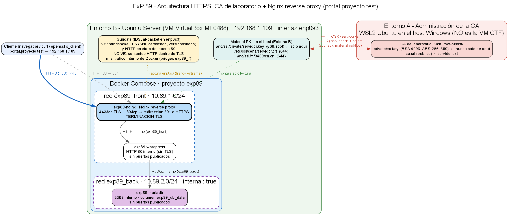

# ExP 89 · Fase 3 — Implementación de HTTPS con Nginx Reverse Proxy y Docker

**Autor:** Volodymyr Osebchuk (vladibcn69@gmail.com)
**Módulo:** MF0489 · Semana 3
**Dominio:** `portal.proyecto.test` · **Servidor:** Ubuntu Server `192.168.1.109`, proyecto Compose en `~/exp89`
**Evidencias:** [`evidencias/fase3/`](evidencias/fase3/) (salidas de texto; sin claves ni contraseñas)

## 1. Arquitectura final y punto de terminación TLS



El cliente habla HTTPS (443) con **Nginx**, que **termina TLS** usando `servidor.crt` y `servidor.key` creados en la Fase 2. Nginx reenvía la petición por HTTP interno a WordPress (`exp89_front`), y WordPress consulta MariaDB (`exp89_back`). El puerto 80 solo devuelve una redirección 301 a HTTPS. La CA (`ca.key`) permanece en el Entorno A (WSL2), fuera del servidor.

## 2. Servicios, redes y puertos: antes y después

| | Antes | Después |
|---|---|---|
| Compose | Sin proyectos Compose; entorno anterior creado con `docker run` | Proyecto nuevo `exp89` en `~/exp89` |
| Contenedores | 4 detenidos de proyectos anteriores (no se tocan) | `exp89-nginx`, `exp89-wordpress`, `exp89-mariadb` |
| Puertos en el host | Solo 22 | 22, **80** y **443** (solo Nginx) |
| Redes | Redes de proyectos anteriores | `exp89_front` 10.89.1.0/24 y `exp89_back` 10.89.2.0/24 (`internal: true`) |
| Volúmenes | Los anteriores | `exp89_wp_data`, `exp89_db_data` |

No se reutiliza ni modifica ningún recurso anterior, por lo que **no hay datos previos que migrar**: WordPress y MariaDB se crean de cero. No se ejecutó `docker compose down -v` (ver `01_estado_previo.txt`).

## 3. Decisiones en Docker Compose y Nginx

1. **Reverse proxy:** un Nginx nuevo (`nginx:stable-alpine`), no uno existente.
2. **Aplicación:** imagen oficial `wordpress:6-php8.3-apache`: habla **HTTP en el puerto 80 del contenedor**, no FastCGI, por lo que `proxy_pass http://wordpress:80`. El puerto 80 interno no se publica en el host.
3. **Red `exp89_front`:** Nginx y WordPress; Nginx resuelve el servicio por el DNS interno de Docker (`wordpress`).
4. **Red `exp89_back`:** WordPress y MariaDB, con `internal: true` (sin salida a Internet). Nginx **no** está en esta red y no ve la base de datos.
5. **TLS:** el tramo cliente → Nginx es HTTPS; Nginx → WordPress → MariaDB es tráfico interno sin cifrar, dentro de Docker (límite documentado en la Fase 1).
6. **Secretos:** contraseñas de la BBDD y del administrador solo en `~/exp89/.env` del servidor (permisos 600, generadas aleatoriamente); el repositorio solo contiene `.env.example`.
7. **Imágenes:** no se construye ninguna imagen con la clave dentro (sin `COPY` de claves); las claves se montan en ejecución.
8. **Compose** (`docker-compose.yml`): `ports` publica solo `80:80` y `443:443` de Nginx; `volumes` monta la configuración y los certificados en **solo lectura** (`:ro`); WordPress y MariaDB no declaran `ports`. MariaDB tiene `healthcheck` y WordPress espera a que esté sano.
9. **`nginx/default.conf`:** bloque `server` en 80 con `return 301 https://$host$request_uri`; bloque en 443 con `ssl_protocols TLSv1.2 TLSv1.3`, el mismo `server_name` que el SAN, y `location /` con `proxy_pass` y las cabeceras `Host`, `X-Real-IP`, `X-Forwarded-For` y `X-Forwarded-Proto`.

**¿Por qué Nginx necesita `servidor.key` y no `ca.key`?** Para demostrar su identidad en el handshake TLS necesita su propia clave privada. `ca.key` solo sirve para firmar certificados y no debe salir del Entorno A. **¿Qué significa `:ro`?** El contenedor puede leer pero no modificar el fichero.

## 4. Rutas de certificados y permisos

| Host | Contenedor Nginx | Permisos |
|---|---|---|
| `/etc/ssl/private/servidor.key` | `/etc/nginx/certs/servidor.key` (`:ro`) | root:root 600 |
| `/etc/ssl/certs/servidor.crt` | `/etc/nginx/certs/servidor.crt` (`:ro`) | root:root 644 |
| `~/exp89/nginx/default.conf` | `/etc/nginx/conf.d/default.conf` (`:ro`) | — |

`docker inspect` confirma `RW=false` en los tres montajes, y escribir en ellos falla con «Read-only file system» (`03_compose_nginx_puertos.txt`). Antes de desplegar se verificó con `openssl verify … -verify_hostname portal.proyecto.test` → **OK** (`02_pki_previa.txt`).

## 5. Resolución DNS en el cliente de laboratorio

El cliente es WSL2 (Entorno A), que solo dispone de `ca.crt`. No se modificó ningún `hosts` (ni el de WSL ni el de Windows): se usa `curl --resolve portal.proyecto.test:443:192.168.1.109` y `openssl s_client -connect IP:443 -servername portal.proyecto.test`. El certificado solo lleva SAN de tipo DNS, por lo que conectar por IP no equivale a validar el nombre. Para usar un navegador de Windows habría que añadir `192.168.1.109 portal.proyecto.test` al `hosts` de Windows (no se ha hecho) e importar `ca.crt` como autoridad de confianza.

## 6. Pruebas HTTP → HTTPS y de confianza TLS (`04_cliente_https.txt`)

- `curl -I --resolve …:80:… http://portal.proyecto.test/` → **301**, `Location: https://portal.proyecto.test/`. Con ruta y query (`/wp-login.php?redirect_to=1`) se conservan host y ruta.
- `curl -v --cacert ca.crt --resolve …:443:… https://portal.proyecto.test/` → TLS 1.3 (`TLS_AES_256_GCM_SHA384`), `subject: CN=portal.proyecto.test`, `issuer: … CN=ExP89 Lab Root CA`, SAN coincide, **HTTP 200, código de salida 0, sin `-k`**.
- Prueba negativa: sin `--cacert`, curl falla con `unable to get local issuer certificate (20)`, como se espera al no estar la CA en el almacén del cliente.
- `openssl s_client … -CAfile ca.crt -verify_hostname portal.proyecto.test -verify_return_error -brief` → `Verification: OK`, `Verified peername: portal.proyecto.test`, TLSv1.3.
- Versiones: TLS 1.2 y 1.3 negociadas. Los intentos con TLS 1.0/1.1 fueron rechazados, pero ese resultado también depende de que el OpenSSL 3.5 del cliente las desactiva por defecto; la auditoría formal de protocolos y cifrados se hace en la Fase 4.

## 7. Funcionamiento de la aplicación y persistencia (`05_aplicacion_bbdd_persistencia.txt`)

- Página principal, `wp-login.php`, `/?p=1` y la API REST responden **200** por HTTPS; `/wp-admin/` redirige (302) al login (1 redirección, **sin bucles**). Ningún **502**.
- La página principal no contiene referencias `http://portal.proyecto.test` (0) y sí 32 `https://…`: no hay contenido mixto. `siteurl` y `home` en la BBDD son `https://portal.proyecto.test` (definidos con `WP_HOME`/`WP_SITEURL`; la imagen oficial interpreta `X-Forwarded-Proto`).
- **Operación real con la BBDD:** WordPress se instaló por HTTPS (usuario administrador creado en `wp_users`); después se creó una entrada por XML-RPC, que se leyó desde MariaDB (`SELECT` en `wp_posts`) y desde la API REST por HTTPS.
- **Persistencia:** `docker compose restart` (sin `down -v`); tras reiniciar, la entrada sigue en la BBDD y accesible por HTTPS, y la web responde 200.
- Segmentación: MariaDB no es alcanzable desde el host (`127.0.0.1:3306` cerrado), desde el cliente (3306, 8080 y 9000 cerrados; solo 22, 80 y 443 abiertos, `06_puertos_desde_cliente.txt`) ni desde Nginx (no resuelve `mariadb`).

## 8. Incidencias reales y soluciones

- **Sin errores 502, bucles de redirección ni contenido mixto**, por lo que no hubo que aplicar los remedios de la guía de ayuda. El resto de incidencias fueron de comprobación:
- **`/wp-json/` devolvía 404:** con enlaces permanentes «simples» la API REST se expone como `/?rest_route=/…`. No es un fallo del proxy; se usó esa forma en las pruebas.
- **Prueba de solo lectura mal planteada:** al principio `touch` en `/etc/nginx/certs/` funcionó, porque `:ro` se aplica a cada fichero montado y el directorio es del contenedor. Se eliminó el fichero de prueba y se repitió la comprobación escribiendo en los ficheros montados (falla correctamente).
- **Aviso de Nginx en el arranque:** `10-listen-on-ipv6-by-default.sh: can not modify default.conf (read-only file system?)`. Es informativo: el script de la imagen intenta añadir IPv6 a la configuración por defecto, que está montada en solo lectura a propósito.
- **Scripts de prueba por SSH:** `docker compose exec` consumía la entrada estándar del script; se resolvió con `-T` y `</dev/null`, y ejecutando los scripts desde fichero.
- **Registros de Nginx:** las pruebas hechas desde el propio servidor aparecen con la IP `10.89.1.1` (puerta de enlace del bridge); `X-Forwarded-For` se transmite a WordPress.
- **UFW:** el servicio está activo pero el cortafuegos está **inactivo** (`INPUT ACCEPT`), por lo que no hizo falta abrir puertos.

## 9. Instrucciones de despliegue y verificación reproducibles

Requisitos: Docker y Compose, los certificados de la Fase 2 instalados en `/etc/ssl/` y el nombre `portal.proyecto.test` resoluble desde el cliente.

```bash
# 1) Copiar docker-compose.yml, nginx/default.conf y .env.example al servidor (scp o git clone)
mkdir -p ~/exp89/nginx        # y copiar los ficheros
cd ~/exp89
# 2) Crear .env a partir de .env.example con contraseñas propias (permisos 600; no versionar)
cp .env.example .env && chmod 600 .env && nano .env
# 3) Validar y arrancar
docker compose config --quiet
docker compose up -d
docker compose ps
docker compose exec reverse-proxy nginx -t
# 4) Instalar WordPress abriendo https://portal.proyecto.test/ (o por curl) y verificar desde el cliente
curl -I --resolve portal.proyecto.test:80:192.168.1.109 http://portal.proyecto.test/
curl -v --cacert ca.crt --resolve portal.proyecto.test:443:192.168.1.109 https://portal.proyecto.test/ -o /dev/null
openssl s_client -connect 192.168.1.109:443 -servername portal.proyecto.test \
  -CAfile ca.crt -verify_hostname portal.proyecto.test -verify_return_error -brief </dev/null
```

**No ejecutar `docker compose down -v`** (borraría los volúmenes y la base de datos). Para detener sin perder datos: `docker compose down`.

## Correspondencia con la rúbrica (4,00 puntos)

| Código | Evidencia |
|---|---|
| F3.1 | `docker-compose.yml`, montajes `:ro`, `docker compose config --quiet` OK (`03_…txt`). |
| F3.2 | Nginx en 443, certificado esperado (`04_…txt`), `nginx -t` correcto (`03_…txt`). |
| F3.3 | Solo 80 y 443 publicados; BBDD en red `internal` y sin puertos (`03_…txt`, `06_…txt`). |
| F3.4 | WordPress operativo tras el proxy, sin 502 ni bucles; operación con la BBDD y persistencia tras reinicio (`05_…txt`). |
| F3.5 | `curl --cacert` sin `-k` y `openssl s_client` con `Verification: OK` (`04_…txt`). |
| F3.6 | `curl -I http://…` → 301 con `Location` https, host y ruta conservados (`04_…txt`). |
